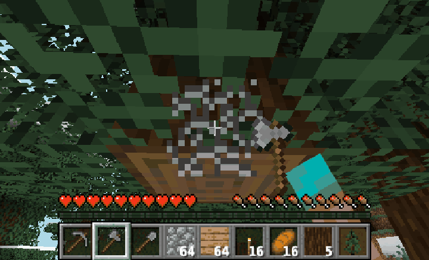

# Agent Office 3D

把你的 AI Coding Agent 變成一間 3D 辦公室裡的員工：誰在工作、誰閒著、誰卡在權限確認，一眼就看得到。閒著的員工會去倒咖啡、上跑步機、摸貓，或是偷玩 Minecraft。

Turn your AI coding agents into staff in a little 3D office. See at a glance who is working, who is idle and who is stuck on a permission prompt. Idle staff grab coffee, hit the treadmill, pet the cat, or sneak in a round of Minecraft.

[English](#english) ・ Built with [Claude Code](https://claude.com/claude-code) ・ Made by SparCode studio


> 畫面都是示範模式（demo），員工、任務、專案和金額全部是虛構的。

## 用 AI Agent 安裝

下載這個 repo 後，在資料夾裡打開你的 AI Coding Agent（Claude Code、Codex、Cursor…），直接貼上這句話：

```text
請讀這個 repo 的 AGENTS.md，幫我把 Agent Office 裝好並打開麥塊示範。
```

Agent 會照 [AGENTS.md](AGENTS.md) 先跑 `npm run doctor` 檢查環境，再幫你安裝、啟動示範，並詢問要不要接 Herdr、怎麼客製公司名稱和員工。安裝 Node.js、Java 這類系統軟體前，它會先問你；Minecraft EULA 一定要你自己輸入 `yes`，Agent 不會代為同意。Claude Code 使用者也可以直接輸入 `/setup-office`。

## 快速看麥塊

不用接自己的 Agent，兩個指令就能看到示範員工偷玩 Minecraft（需要 Node.js 20 以上、Java 21 以上）：

```bash
npm ci
npm run demo:minecraft
```

第一次執行會先跑 `minecraft:setup`：檢查 Java、請你同意 Minecraft EULA、從 Mojang 官方下載伺服器並驗證。產生世界約 1～2 分鐘，機器人進世界後自動打開瀏覽器，幾秒內就會有員工開始玩。按 `Ctrl+C` 停止，世界會先存檔。

**為什麼要你自己輸入 `yes`？** Minecraft 伺服器軟體屬於 Mojang，執行前必須由使用者本人同意 [Minecraft EULA](https://aka.ms/MinecraftEULA)。這個 repo 不能也不會替你同意，所以不附任何 Mojang 檔案，也不會跳過這一步；你不同意的話，就不會下載任何東西。

只想看辦公室（不需要 Java）：`npm start`。

⭐ 覺得有趣的話，歡迎幫這個 repo 點個星星，讓更多人看到！
⭐ If you find this fun, a star on the repo would mean a lot!

## 功能

- **員工即時狀態**：每位 Agent 一個座位，狀態燈與名牌顯示「工作中／閒置／完成待命／需要確認」。需要確認時名牌變紅、頭上冒驚嘆號。
- **看終端畫面**：點員工可以看他最近的終端輸出（只讀，不能從這裡下指令）。
- **閒置時的小動作**：倒咖啡、喝水、跑步機、伸懶腰、打瞌睡、偷玩內建小遊戲；有開 Minecraft 的話，螢幕上是他自己的 Minecraft 機器人第一人稱畫面。
- **布告欄**：年度目標、KPI、本週重點、現金流、待辦清單。點布告欄會飛過去打開全螢幕介面，待辦可以直接勾選。
- **書架＝專案資料庫**：每本書是一個專案資料夾，點了可以看裡面的 Markdown 文件和截圖（只讀）。
- **任務清單**：右側列出任務資料夾裡的檔案，點了看全文。
- **一隻貓**：在走道散步、趴睡、跳上空桌。

| 布告欄 | 書架專案介面 |
|---|---|
|  |  |

## 需求

- **Node.js 20 以上**（必要）
- **Java 21 以上＋ Minecraft Java 版伺服器**（選用，只有想讓員工玩 Minecraft 才需要）
- 一個支援 WebGL 的瀏覽器（Chrome、Edge、Safari、Firefox）

支援平台：macOS、Linux。**Windows 為實驗性支援**：CI 會在 Windows 上跑安裝、語法檢查與示範模式測試，但作者沒有 Windows 實機驗證過，Minecraft 在 Windows 上也還沒實測。

## 安裝與啟動

### macOS／Linux

```bash
git clone https://github.com/jefferysha0627/agent-office-3d.git agent-office-3d
cd agent-office-3d
npm ci
npm start
```

### Windows（PowerShell）

```powershell
git clone https://github.com/jefferysha0627/agent-office-3d.git agent-office-3d
cd agent-office-3d
npm ci
npm start
```

啟動後會自動打開 http://127.0.0.1:4870/ 。預設是**示範模式**：不需要任何 Agent，員工狀態會自動輪播，讓你先看到效果。按 `Ctrl+C` 停止。

## 設定

把 `office.config.example.json` 複製成 `office.config.json` 再修改（`office.config.json` 不進版控）。沒有 `office.config.json` 時會直接用範例設定。

```bash
cp office.config.example.json office.config.json        # macOS／Linux
Copy-Item office.config.example.json office.config.json  # Windows PowerShell
```

| 欄位 | 說明 |
|---|---|
| `port` | 連接埠，預設 `4870` |
| `openBrowser` | 啟動後是否自動開瀏覽器 |
| `company.name` | 公司名稱（標題列） |
| `company.currency` | 布告欄的貨幣符號，例如 `$`、`NT$` |
| `company.logo` | 牆上招牌的 Logo（寬版圖，SVG／PNG／JPG），路徑相對於專案資料夾 |
| `company.mark` | 小圖示（標題列、網頁圖示、制服徽章），建議正方形 |
| `owner.name`、`owner.title` | 坐在主管桌的人（你）的名字與職稱。主管桌只是擺設，不接任何狀態 |
| `cat.name` | 貓的名字 |
| `staff[]` | 員工清單：`id`（Agent 名稱，要和狀態來源裡的名字一樣）、`title`（職稱）、`color`（制服滾邊顏色）。最多 8 位，依序坐前排再坐後排；剩下的座位給清單以外的 Agent |
| `source.type` | 狀態來源：`demo`（假狀態輪播，預設）或 `herdr` |
| `source.herdr.bin` | Herdr 執行檔，預設找 PATH 上的 `herdr`；也可以寫完整路徑 |
| `source.herdr.args` | 加在每個 herdr 指令前面的參數（一般不用設） |
| `data.board` | 布告欄資料，預設 `data/board.json`（第一次啟動從 `data/board.example.json` 複製） |
| `data.projects` | 書架的專案資料夾，預設 `data/projects` |
| `data.tasks` | 任務清單資料夾，預設 `data/tasks` |
| `minecraft.enabled` | 是否啟動 Minecraft，預設 `false` |
| `minecraft.java` | Java 執行檔，預設 `java` |
| `minecraft.memory` | Minecraft 伺服器記憶體上限，預設 `2G` |
| `minecraft.guests` | 可以進遊戲看員工的真人玩家名稱（陣列），預設空的；也可以用環境變數 `MC_GUESTS=name1,name2` |

布告欄與書架的資料格式見 [docs/board-format.md](docs/board-format.md)。

### 接上真的 Agent：Herdr 模式

[Herdr](https://github.com/herdrdev/herdr) 是給 Coding Agent 用的終端機多工工具。用 Herdr 開好你的 Agent 之後：

1. `office.config.json` 的 `source.type` 改成 `"herdr"`。
2. `staff[].id` 改成你在 Herdr 裡的 Agent 名稱。
3. `npm start`。

辦公室只會呼叫 Herdr 的唯讀指令（`herdr agent list`、`herdr agent read`），程式裡有白名單擋住其他指令，不會送鍵、不會替你按確認。Herdr 在 Windows 上目前是 beta；Herdr 模式在 Windows 上未經實測。

想接其他工具？在 `lib/sources.js` 加一個 adapter，回傳同樣格式的員工清單（名稱、狀態、終端最後幾行）即可。

## Minecraft（選用）

員工閒置時會進同一個 Minecraft 世界：挖礦、砍樹、蓋小屋。每位員工一個 [Mineflayer](https://github.com/PrismarineJS/mineflayer) 機器人，畫面用 [prismarine-viewer](https://github.com/PrismarineJS/prismarine-viewer) 串到他桌上的螢幕。



```bash
npm run minecraft:setup
```

這個指令會依序：

1. 檢查 Java 21 以上；沒有的話，顯示 macOS、Windows、Linux 的安裝方式。
2. 顯示 [Minecraft EULA](https://aka.ms/MinecraftEULA) 連結，**你自己讀完並輸入 `yes`** 才會寫入 `eula=true`。輸入其他內容就取消，不會下載任何東西。
3. 從 Mojang 官方版本清單下載 1.21.4 伺服器 jar，並驗證 sha1。
4. 寫入只綁 `127.0.0.1` 的 `server.properties`（白名單只有辦公室的機器人）。

完成後把 `office.config.json` 的 `minecraft.enabled` 改成 `true`，再 `npm start`。第一次產生世界約需 1～2 分鐘。只想先看示範的話，用 `npm run demo:minecraft` 就好（示範員工＋Minecraft，不用改設定檔）。

- 開了 Minecraft 時，偷玩遊戲一律是 Minecraft，不會換成內建小遊戲；機器人還沒連上時螢幕先顯示載入中。
- 機器人只在員工閒置、而且有人開著辦公室畫面時才會動；員工一回去工作，機器人就停下來。
- 示範模式會讓閒置的員工先去玩 Minecraft、也比較常玩；接真的 Agent 時維持原本的機率（約 12%）。
- 資源用量參考（macOS、5 個機器人、有人在看）：Minecraft 伺服器約 450 MB 記憶體，機器人程序與辦公室伺服器各約 170 MB，CPU 合計約一顆核心的 15%。

### 從遊戲裡看你的員工

有 Minecraft Java 版的話，可以自己進同一個世界，飛到員工旁邊看他們挖礦、砍樹、蓋房子。

1. 把你的 Minecraft 玩家名稱（3～16 個英數字或底線，下面用 `YourName` 舉例）加進設定：`office.config.json` 的 `"minecraft": { "guests": ["YourName"] }`，或是啟動時用環境變數：

   ```bash
   MC_GUESTS=YourName npm run demo:minecraft                    # macOS／Linux
   $env:MC_GUESTS="YourName"; npm run demo:minecraft            # Windows PowerShell
   ```

2. 終端機會印出連線方式。在**同一台電腦**打開 Minecraft Java 版，版本選 **1.21.4**，多人遊戲 → 直接連線 → `localhost:25570`。
3. 進來後會自動變成**觀察者模式**：可以飛、穿牆，不會碰到世界。按數字鍵 `1`（或滑鼠中鍵打開觀察者選單）選員工，就能跳到他身上看。

設定的名稱會跟機器人一起放進白名單，不在名單上的人連不進來。

> 提醒：這個伺服器是離線模式（機器人不需要正版帳號），而且只綁 `127.0.0.1`，只能在這台電腦上使用。不要改綁定位址或開放對外連線。

- 這個 repo 不包含任何 Mojang 的檔案；伺服器 jar、EULA、世界存檔都在本機的 `minecraft/`，不進版控。
- 在 `npm start` 的終端機輸入文字會轉給 Minecraft 主控台（例如 `time set day`、`list`）。
- 關閉時會先讓機器人離線，再請伺服器存檔關閉。

## 常見問題

**玩 Minecraft 會耗 Token 嗎？**
不會。Minecraft 裡的員工是照規則跑的 Mineflayer 機器人（找樹、挖礦、蓋東西），不會呼叫任何 AI 模型。只有你的 Agent 真的在工作時才會用到 Token，而且那跟這個辦公室無關。

**辦公室會替我的 Agent 下指令嗎？**
不會。辦公室只讀狀態和終端畫面；唯一的寫入是在布告欄勾選待辦（寫進 `data/board.json`）。

**不用接自己的 Agent 也看得到嗎？**
看得到。`npm start` 是示範辦公室，`npm run demo:minecraft` 是示範員工加上 Minecraft，都不需要任何 Agent。之後想接真的 Agent，再看下面的「Herdr 模式」。

**為什麼我的員工都「不在線」？**
Herdr 模式下，`staff[].id` 要和 `herdr agent list` 裡的名稱完全一樣。

## 安全提醒

- 這個辦公室會**讀取你的 Agent 終端畫面**，裡面可能有程式碼、路徑或其他敏感內容。
- 伺服器只綁 `127.0.0.1`，並檢查 Host 標頭（防 DNS rebinding）。**不要改成對外開放，也不要用反向代理或通道把它公開到網路上。**
- 唯一的寫入 API（勾選待辦）要求同源、JSON 與自訂標頭。
- 書架只讀你設定的資料夾，擋路徑穿越與跳出去的符號連結；疑似含金鑰的檔案不會列出。即使如此，也不要把密碼或 token 放在專案資料夾裡。
- Minecraft 伺服器只綁 `127.0.0.1`，並開啟白名單。

## 開發

```bash
npm run doctor  # 唯讀環境檢查（結束碼 0 全部就緒、2 Minecraft 未就緒、1 辦公室不能跑；加 -- --json 輸出 JSON）
npm run check   # 所有 JS 語法檢查＋ JSON 格式檢查
npm run smoke   # 示範模式冒煙測試（啟動伺服器、打 API、關閉）
```

網址參數（開發用）：`?fast`（動作加速）、`?idle=coffee`（閒置員工都做某個動作，名稱見 `public/behavior.js`）、`?cat=nap`（貓的行程）。

```
server.js              本機伺服器（只綁 127.0.0.1）
lib/config.js          讀設定檔
lib/sources.js         狀態來源 adapter（demo、herdr）
lib/board-store.js     布告欄資料
lib/projects-store.js  書架專案資料庫（只讀）
public/                前端（Three.js）
mc/                    Minecraft 機器人與畫面串流
scripts/               doctor、minecraft:setup、demo:minecraft、語法檢查、冒煙測試
AGENTS.md              給 AI Agent 的安裝流程與硬性界線（CLAUDE.md、.claude/commands/setup-office.md 指向它）
data/                  範例資料（全部虛構）
```

## 第三方套件與授權

本專案以 [MIT License](LICENSE) 授權，著作權人 Jeffery Sha。

| 套件 | 授權 | 用途 |
|---|---|---|
| [three](https://github.com/mrdoob/three.js) | MIT | 3D 辦公室 |
| [mineflayer](https://github.com/PrismarineJS/mineflayer) | MIT | Minecraft 機器人 |
| [mineflayer-pathfinder](https://github.com/PrismarineJS/mineflayer-pathfinder) | MIT | 機器人尋路 |
| [prismarine-viewer](https://github.com/PrismarineJS/prismarine-viewer) | MIT | 機器人第一人稱畫面 |
| [socket.io](https://github.com/socketio/socket.io)（透過 prismarine-viewer） | MIT | 畫面串流 |

其他間接相依套件以 MIT、BSD、ISC、Apache-2.0 為主，完整清單見 `package-lock.json`，各套件授權見 `node_modules/<套件>/LICENSE`。prismarine-viewer 套件內附的方塊材質屬於 Mojang，受 Minecraft 使用條款約束；本 repo 本身不包含任何 Mojang 檔案。

本專案與 Mojang、Microsoft 無關，也未獲其認可。Minecraft 是 Mojang Synergies AB 的商標。

---

## English

Agent Office 3D renders your AI coding agents as staff in a small low-poly 3D office running on your own machine.

### Install with an AI agent

Clone the repo, open your AI coding agent (Claude Code, Codex, Cursor, …) in the folder and paste:

```text
Read this repo's AGENTS.md and set up Agent Office for me, then open the Minecraft demo.
```

The agent follows [AGENTS.md](AGENTS.md): it runs `npm run doctor`, installs and starts the demo, then asks whether to connect Herdr and how to customize the company name and staff. It asks before installing system software such as Node.js or Java, and it will never accept the Minecraft EULA for you: you type `yes` yourself. Claude Code users can also type `/setup-office`.

### Features

- **Live status** for each agent: working / idle / done / needs confirmation (red name tag and a "!" bubble).
- **Read-only terminal view**: click a staff member to see their recent terminal output. You cannot send commands from the office.
- **Idle animations**: coffee, water, treadmill, stretching, napping, built-in mini games, or **Minecraft** (each agent gets a Mineflayer bot whose first-person view shows up on their monitor).
- **Bulletin board**: yearly goal, KPIs, weekly focus, cash flow and a to-do list you can tick off.
- **Bookshelf project library**: each book is a project folder; click it to read its Markdown files and screenshots (read-only).
- **Task list** sidebar and an office cat.

### Requirements

- **Node.js 20+** (required)
- **Java 21+ and the Minecraft Java Edition server** (optional, only for Minecraft breaks)
- A WebGL-capable browser

macOS and Linux are supported. **Windows support is experimental**: CI runs install, syntax checks and a demo-mode smoke test on Windows, but it has not been tested on real Windows hardware, and Minecraft on Windows is untested.

### Quick start

```bash
git clone https://github.com/jefferysha0627/agent-office-3d.git agent-office-3d
cd agent-office-3d
npm ci
npm start
```

The office opens at http://127.0.0.1:4870/ in **demo mode**: fake statuses rotate so you can see it working without any agent. Press `Ctrl+C` to stop.

**See the Minecraft breaks** (Java 21+ required), still without connecting any agent:

```bash
npm ci
npm run demo:minecraft
```

On first run it calls `minecraft:setup` (Java check, Minecraft EULA, official download with SHA-1 check). The world takes 1–2 minutes to generate; the browser opens once the bots are in, and within seconds a demo staff member starts playing. `Ctrl+C` saves the world and stops everything.

**Why do you have to type `yes` yourself?** The Minecraft server belongs to Mojang, and its [EULA](https://aka.ms/MinecraftEULA) must be accepted by you, the person running it. This repo cannot accept it for you, so it ships no Mojang files and never skips that step. If you don't agree, nothing is downloaded.

### Configuration

Copy `office.config.example.json` to `office.config.json` and edit it (it is git-ignored). Key fields: `company` (name, currency, logo), `owner` (the person at the front desk), `staff[]` (`id` must match the agent name in your status source, plus `title` and uniform `color`, up to 8), `source.type` (`demo` or `herdr`), `data.*` (board, bookshelf and task folders) and `minecraft.*`. See the Chinese table above for every field and [docs/board-format.md](docs/board-format.md) for the board and bookshelf data format.

**Herdr mode**: set `source.type` to `"herdr"` and use your [Herdr](https://github.com/herdrdev/herdr) agent names as `staff[].id`. The office only runs the read-only commands `herdr agent list` and `herdr agent read`, enforced by an allowlist. To support another tool, add an adapter in `lib/sources.js`.

### Minecraft (optional)


```bash
npm run minecraft:setup
```

1. Checks for Java 21+ and prints install instructions for macOS, Windows and Linux if missing.
2. Shows the [Minecraft EULA](https://aka.ms/MinecraftEULA). **You must read it and type `yes` yourself**; anything else cancels without downloading anything.
3. Downloads the 1.21.4 server jar from Mojang's official version manifest and verifies its SHA-1.
4. Writes a `server.properties` bound to `127.0.0.1` with a whitelist.

Then set `minecraft.enabled` to `true` and run `npm start` (or just `npm run demo:minecraft` for the demo staff, no config change needed). No Mojang files are included in this repo.

- With Minecraft on, game breaks are always Minecraft (a loading screen shows until the bot connects).
- Bots only move while their staff member is idle and someone is watching the office; they stop as soon as the agent goes back to work.
- Demo mode sends newly idle staff to Minecraft first and picks it more often; real agents keep the normal odds (about 12%).
- Rough resource use (macOS, 5 bots, page open): Minecraft server ~450 MB RAM, bot process and office server ~170 MB each, about 15% of one CPU core in total.

#### Watch your staff from inside the game

If you own Minecraft Java Edition, you can join the same world and fly next to your staff while they mine, chop and build.

1. Add your Minecraft player name: `"minecraft": { "guests": ["YourName"] }` in `office.config.json`, or use an environment variable when starting:

   ```bash
   MC_GUESTS=YourName npm run demo:minecraft                    # macOS/Linux
   $env:MC_GUESTS="YourName"; npm run demo:minecraft            # Windows PowerShell
   ```

2. The terminal prints how to connect. On **the same computer**, open Minecraft Java Edition **1.21.4** → Multiplayer → Direct Connection → `localhost:25570`.
3. You are switched to **spectator mode** automatically: fly, pass through walls, never touch the world. Press `1` (or the middle mouse button for the spectator menu) and pick a staff member to jump into their view.

Guest names are added to the whitelist together with the bots; anyone else is rejected.

> Note: the server runs in offline mode (the bots don't need accounts) and only listens on `127.0.0.1`, so it only works on this computer. Do not change the bind address or open it to the network.

### FAQ

**Does Minecraft burn tokens?** No. The in-game staff are rule-based Mineflayer bots (chop trees, mine, build). They never call an AI model.

**Can I see it without connecting my own agents?** Yes. `npm start` runs the demo office and `npm run demo:minecraft` adds Minecraft, no agent needed.

**Can the office control my agents?** No. It only reads status and terminal output. The only write is ticking a to-do on the board.

### Security

- The office **reads your agents' terminal output**, which may contain code, paths or other sensitive data.
- The server binds to `127.0.0.1` only and checks the Host header. **Do not expose it to the network**, and do not put it behind a public proxy or tunnel.
- The only write endpoint (ticking a to-do) requires same-origin, JSON and a custom header.
- The bookshelf only reads the folder you configure, blocks path traversal and escaping symlinks, and hides files that look like they contain secrets.

### Credits and license

Built with [Claude Code](https://claude.com/claude-code). Made by SparCode studio.

[MIT License](LICENSE), copyright Jeffery Sha. Third-party packages: three, mineflayer, mineflayer-pathfinder, prismarine-viewer and socket.io (all MIT); see the table above. Not affiliated with or endorsed by Mojang or Microsoft. Minecraft is a trademark of Mojang Synergies AB.
